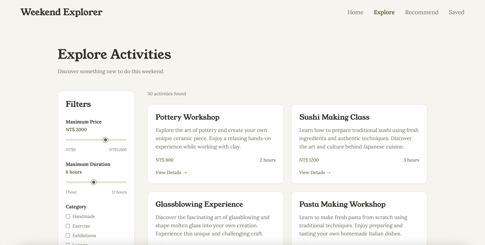

# Weekend Explorer
A full-stack web application that helps users discover activities for their weekends based on their interests, preferences, and available time.

Weekend Explorer allows users to browse and filter activities, receive personalized recommendations through an interactive quiz, view activity details, and save activities for later.

**Live Demo:** [Weekend Explorer](https://weekend-explorer-frontend.vercel.app)

**Project Type:** Full-stack Personal Project

## Table of Contents

- [Screenshots](#screenshots)
- [Features](#features)
- [Tech Stack](#tech-stack)
- [System Architecture](#system-architecture)
- [API Overview](#api-overview)
- [Database Design](#database-design)
- [Technical Highlights & Challenges](#technical-highlights--challenges)
- [Testing](#testing)
- [Getting Started](#getting-started)
- [Deployment](#deployment)
- [Future Improvements](#future-improvements)

## Screenshots

### Home

### Explore Activities

### Recommendation Quiz

### Recommendation Results

### Saved Activities

## Features

- **Activity Discovery:** Browse available activities and view detailed activity information.
- **Activity Filtering:** Filter activities by price, duration, category, and environment.
- **Personalized Recommendations:** Complete an interactive 10-question quiz to receive activity recommendations based on personal preferences.
- **Saved Activities:** Save favorite activities for later and retain saved items using Local Storage.

## Tech Stack

| Category | Technologies |
| --- | --- |
| **Frontend** | React, TypeScript, Vite |
| **Backend** | Java 21, Spring Boot, Spring Data JPA, Hibernate, Maven |
| **Database** | MySQL, Flyway |
| **Testing** | JUnit 5, Mockito, H2 |
| **Deployment & Infrastructure** | Docker, Render, Vercel, Aiven |

## System Architecture

## API Overview

## Database Design

## Technical Highlights & Challenges

## Testing

## Getting Started

## Deployment

## Future Improvements
