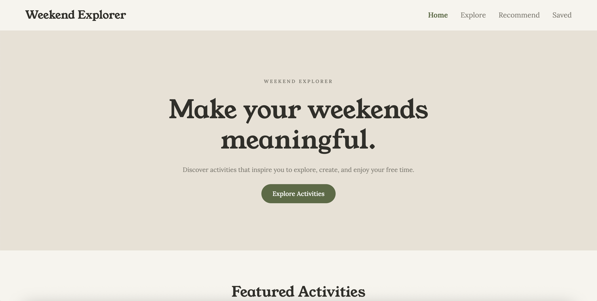
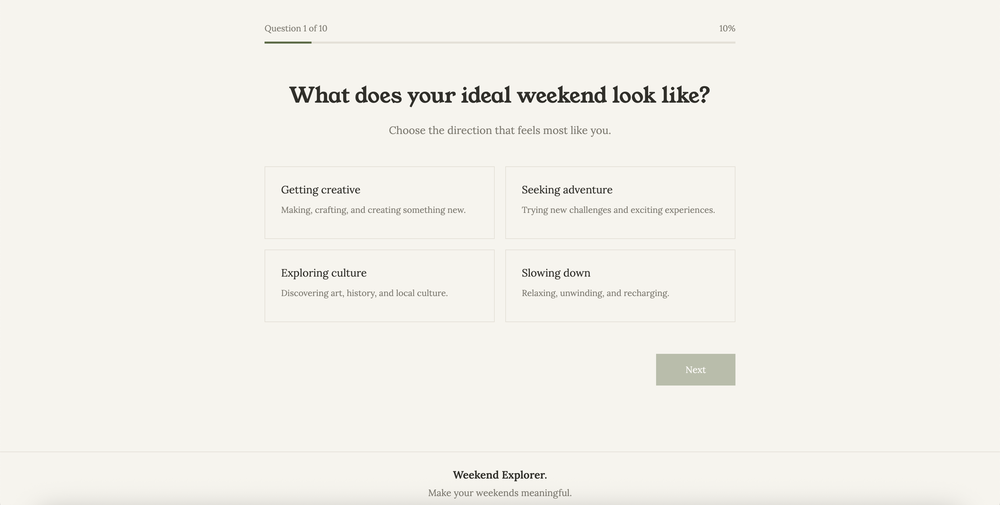
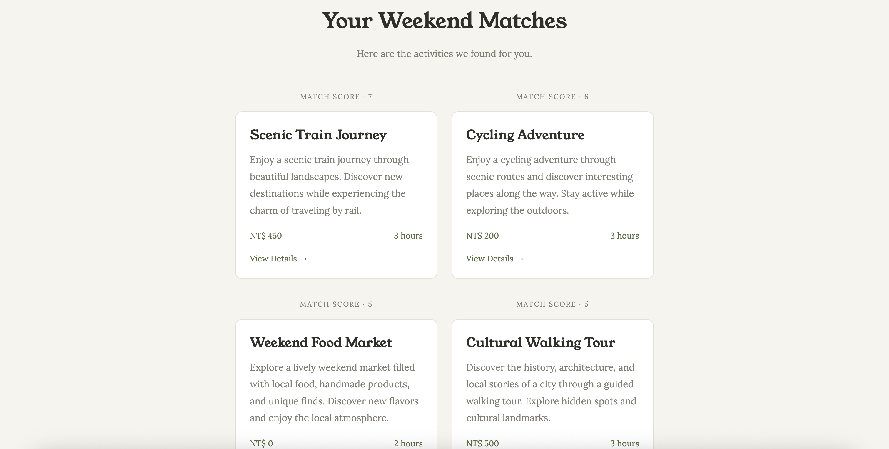
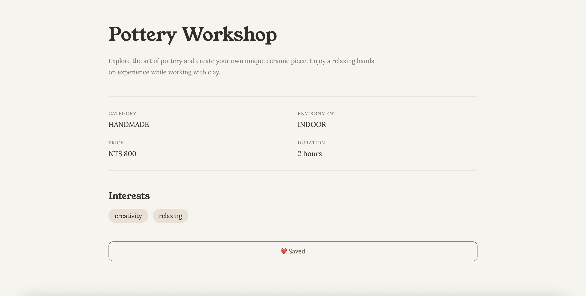
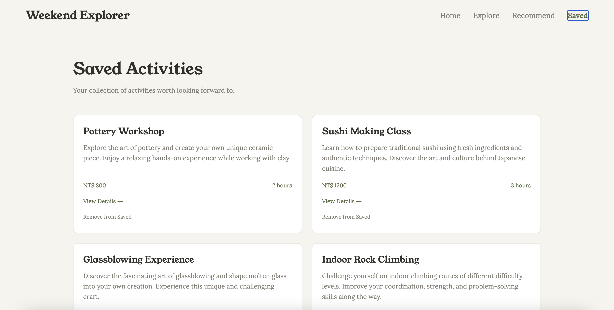
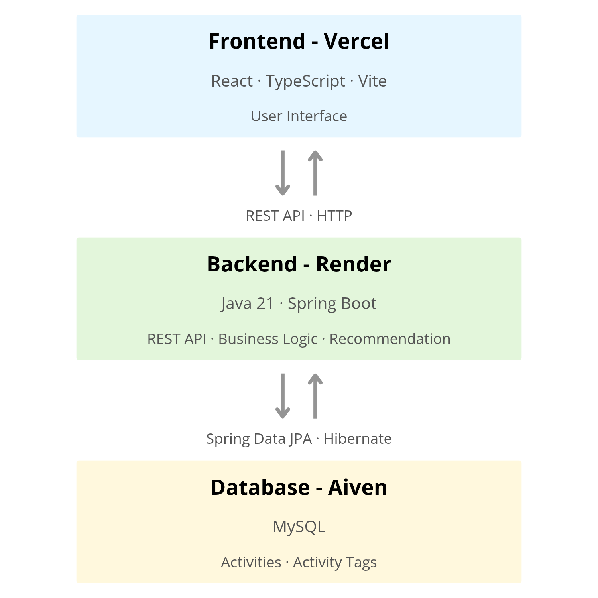
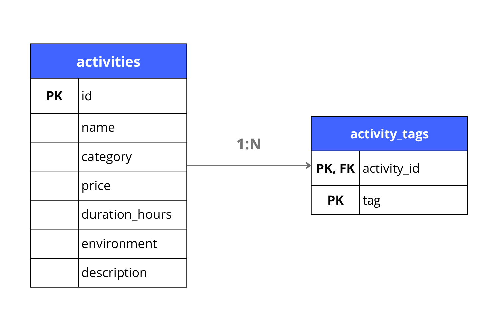

# Weekend Explorer
A full-stack web application that helps users discover activities for their weekends based on their interests, preferences, and available time.

Weekend Explorer allows users to browse and filter activities, receive personalized recommendations through an interactive quiz, view activity details, and save activities for later.

**Live Demo:** [Weekend Explorer](https://weekend-explorer-frontend.vercel.app)
> **Note:** The backend is hosted on Render's free tier and may take a minute to wake up after a period of inactivity. Please allow some time for the initial loading.

**Project Type:** Full-stack Personal Project

## Table of Contents

- [Screenshots](#screenshots)
- [Features](#features)
- [Tech Stack](#tech-stack)
- [System Architecture](#system-architecture)
- [API Overview](#api-overview)
- [Database Design](#database-design)
- [Technical Highlights & Challenges](#technical-highlights--challenges)
- [Testing](#testing)
- [Getting Started](#getting-started)
- [Deployment](#deployment)
- [Future Improvements](#future-improvements)

## Screenshots

### Home
<p align="center">
  
</p>

### Explore Activities
<p align="center">
  
</p>

### Recommendation Quiz
<p align="center">
  
</p>

### Recommendation Results
<p align="center">
  
</p>

### Activity Detail
<p align="center">
  
</p>

### Saved Activities
<p align="center">
  
</p>

## Features

- **Activity Discovery:** Browse available activities and view detailed activity information.
- **Activity Filtering:** Filter activities by price, duration, category, and environment.
- **Personalized Recommendations:** Complete an interactive 10-question quiz to receive activity recommendations based on personal preferences.
- **Saved Activities:** Save favorite activities for later and retain saved items using Local Storage.

## Tech Stack

| Category | Technologies |
| --- | --- |
| **Frontend** | React, TypeScript, Vite |
| **Backend** | Java 21, Spring Boot, Spring Data JPA, Hibernate, Maven |
| **Database** | MySQL, Flyway |
| **Testing** | JUnit 5, Mockito, H2 |
| **Deployment & Infrastructure** | Docker, Render, Vercel, Aiven |

## System Architecture
<p align="center">
  
</p>

## API Overview

| Method | Endpoint | Description |
| --- | --- | --- |
| GET | /api/activities | Retrieve all activities |
| GET | /api/activities/{id} | Retrieve activity details by ID |
| GET | /api/activities/filter | Filter activities by price, duration, category, and environment |
| GET | /api/activities/recommend | Get activity recommendations based on the user's selected conditions and interests |
| POST | /api/activities/recommend/quiz | Get personalized recommendations based on quiz answers |

**API Documentation:** [Swagger UI](https://weekend-explorer-backend.onrender.com/swagger-ui/index.html)

## Database Design
<p align="center">
  
</p>

Activity tags are managed using JPA's `@ElementCollection`,
with a composite primary key consisting of `activity_id` and `tag`.

## Technical Highlights & Challenges

### 1. JPA Data Loading & Query Optimization

**Challenge:**  
Initially, retrieving activities with their associated tags caused the N+1 query problem. Instead of fetching all required data efficiently, Hibernate executed additional queries for each activity to load its tags.

**Solution:**  
- Used `JOIN FETCH` to retrieve activities and their associated tags in a single query.
- Applied `DISTINCT` to avoid duplicate activity results caused by joining collection data.
- Disabled Open Session in View (`spring.jpa.open-in-view=false`) to make database access boundaries explicit.
- Used DTO mapping to ensure required data was loaded before returning API responses.

**Result:**  
Reduced the number of SQL queries for retrieving all 50 activities from 51 to 1, improving the measured Time to First Byte (TTFB) from approximately 5.46 seconds to 480 milliseconds.

### 2. DTO Design & Separation of Concerns

**Challenge:**  
Using JPA entities directly in API responses can expose database-specific structures and tightly couple the API layer to the persistence layer.

**Solution:**  
- Introduced `QuizRequest` to handle incoming quiz data and `ActivityResponse` to define the API response structure.
- Used `QuizCriteria` as an internal representation of recommendation criteria, separating business logic from API request objects.
- Mapped JPA entities to response DTOs in the service layer, keeping database entities independent of the API contract.

**Result:**  
Established clearer boundaries between the persistence, business logic, and API layers, making the application easier to maintain and extend.

### 3. Recommendation Algorithm & Backend Integration

**Challenge:**  
The recommendation feature needed to translate users' quiz answers into meaningful activity recommendations while supporting different combinations of preferences.

**Solution:**  
- Designed a weighted scoring algorithm that evaluates activities against multiple quiz criteria, including interests, energy level, environment, and preferred atmosphere.
- Assigned different weights to criteria based on their relevance to user preferences.
- Separated quiz input validation from recommendation logic using request DTOs and internal criteria objects.
- Integrated the recommendation API with the React frontend, allowing quiz answers to be submitted and matching activities to be displayed with their scores.

**Result:**  
Implemented an end-to-end recommendation flow that converts user preferences into ranked activity suggestions through a 10-question interactive quiz.

## Testing

The project uses JUnit 5, Mockito, and H2 to test different layers of the backend independently, along with integration tests to verify the interaction between components.

| Test Layer | Testing Approach | Coverage |
|---|---|---|
| Controller | `@WebMvcTest` with `@MockitoBean` | API endpoints, request validation, and HTTP responses |
| Service | JUnit 5 with Mockito | Business logic, filtering, and recommendation scoring |
| Repository | `@DataJpaTest` with H2 | JPA entity mapping and database operations |
| Integration | `@SpringBootTest` with `MockMvc` | API request flow across multiple application layers |

**Testing Strategy:**
- Used mocked dependencies to isolate controller and service logic.
- Used H2 as an in-memory database for repository and integration tests, avoiding reliance on the production database.
- Verified successful requests, invalid input scenarios, and interactions between application layers.

## Getting Started

### Prerequisites

Make sure the following tools are installed:

- Java 21
- Node.js and npm
- MySQL

### 1. Clone the Repository

```bash
git clone https://github.com/jess1115/weekend-explorer.git
cd weekend-explorer
```

### 2. Backend Setup

Copy the environment variable template:

```bash
cp .env.backend.example .env.backend
```

Configure the database connection and other settings in `.env.backend`:

| Variable | Description |
|---|---|
| `DB_URL` | MySQL database connection URL |
| `DB_USERNAME` | MySQL username |
| `DB_PASSWORD` | MySQL password |
| `SHOW_SQL` | Whether to display SQL statements |
| `DATA_IMPORT_ENABLED` | Whether to import demo data |

Load the environment variables and start the Spring Boot application:

```bash
set -a
source .env.backend
set +a

./mvnw spring-boot:run
```

The backend will be available at:

`http://localhost:8080`

### 3. Frontend Setup

Navigate to the frontend directory:

```bash
cd frontend
```

Install dependencies:

```bash
npm install
```

Copy `.env.example` to `.env.local` and configure the API base URL:

```bash
cp .env.example .env.local
```

Set the following value in `.env.local`:

```env
VITE_API_BASE_URL=http://localhost:8080
```

Start the development server:

```bash
npm run dev
```

The frontend will be available at:

`http://localhost:5173`

### 4. API Documentation

Once the backend is running, access Swagger UI to explore and test the API endpoints:

`http://localhost:8080/swagger-ui/index.html`

## Deployment

The application is deployed using the following services:

| Component | Platform | Deployment Details |
|---|---|---|
| **Frontend** | Vercel | React application deployed from GitHub |
| **Backend** | Render | Spring Boot application containerized with Docker |
| **Database** | Aiven | Managed MySQL database |

**Deployment Workflow:**
- Connected the GitHub repository to Vercel and Render for automatic deployments.
- Used a multi-stage Docker build to package and run the Spring Boot application.
- Configured environment variables for database connectivity and frontend-backend communication.
- Used Flyway to manage database schema migrations.

## Future Improvements

- **User Authentication & Authorization:** Introduce user accounts and authentication to support personalized experiences and user-specific saved activities.
- **Activity Management:** Implement CRUD operations to allow authorized administrators or activity providers to manage activity listings.
- **Recommendation Algorithm:** Further refine the weighted scoring algorithm to improve recommendation relevance and personalization.
- **Search & Filtering:** Add keyword search and more advanced filtering options to improve activity discovery.
